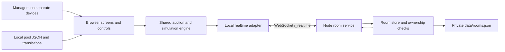

# Implementation and maintenance guide

## Design

The browser keeps the public application's HTML/CSS and classic-script game engine. Reusing the actual delivered game code preserves many details that a screenshot-based rewrite would miss: positional cover, selection distributions, AI valuations, late bids, sealed rounds, timers, tournament statistics, and mobile pitch behavior.

The original Firebase dependency is replaced by an independently implemented same-origin WebSocket service. No production Firebase configuration is included. This also makes the whole application runnable without external accounts.



Shared-screen and AI play run entirely in the browser after assets load. For online play, the host's browser executes the original round engine while the server stores and broadcasts shared state and validates participant writes/bids.

## Frontend module order

`public/index.html` loads ordinary scripts in dependency order. Do not convert individual tags to `async` or reorder them without retesting the whole application. Top-level lexical declarations are intentionally shared across scripts.

| Module | Responsibility |
| --- | --- |
| `js/i18n.js` | Locale loading, fallback strings, direction, language picker |
| `js/realtime.js` | WebSocket transport, request correlation, listeners, transactions, reconnect |
| `js/multiplayer-config.js` | Shared online state, presence setup, clock correction |
| `js/modes/classic.js` | Classic formations, cover map, economy, selection and simulation parameters |
| `js/modes/sixv6.js` | Futsal formations, broad position categories and mode-specific parameters |
| `js/modes/registry.js` | Active-mode globals, slot labels, eligibility and concrete-slot resolution |
| `js/config.js` | Shared helpers, reroll caps, sealed-round helpers, name/nationality rendering |
| `js/players.js` | Pool loading, picker UI, coverage checks, selection, pricing and flash picks |
| `js/ai.js` | Manager profiles, valuation, thinking loop, bidding and passing |
| `js/setup.js` | Local state, settings, sound/haptics and setup controls |
| `js/auction.js` | Local round engine, bidder UI, reserves, timer, settlement, rerolls and pause |
| `js/results.js` | Results, pitches, simulation, statistics, awards, exports and PNG sharing |
| `js/ui.js` | Navigation, dialogs, zoom controls and PWA installation controls |
| `js/multiplayer.js` | Room lifecycle, host engine, guest actions, shared rendering, chat and reconnect |
| `js/tutorial.js` | First-run language/tutorial and live control walkthroughs |

`track()` is a no-op in this clone. Player/translation/font fetches are relative local URLs. The original social links are ordinary outbound hyperlinks, not loaded third-party resources.

## Realtime protocol

The HTTP server serves application files and `GET /api/health`. A WebSocket upgrade at `/_realtime` carries JSON messages. Browser origins must match the request host or an explicit `ALLOWED_ORIGINS` entry.

Every request has an `id` and `op`. Replies echo `id` and contain `ok: true`, or `ok: false` with an error/code. The first message is `hello` with a random per-tab bearer token; the reply supplies server time for midpoint clock correction. Tokens are held in session storage and are not placed in URLs. The server persists only their SHA-256 ownership hashes.

| Operation | Fields | Purpose |
| --- | --- | --- |
| `hello` | `token` | Establish a tab session and return server clock |
| `get` | `path`, optional `limit` | Read a room/subtree and its revision |
| `set` | `path`, `value`, optional `context` | Set/remove a node; create a room or join a seat |
| `update` | `path`, `value` map, optional `context` | Apply nonoverlapping relative paths atomically in one room |
| `subscribe` | `path`, `subscription`, optional `limit` | Receive initial and changed value snapshots |
| `unsubscribe` | `subscription` | Detach a listener |
| `cas` | `path`, `revision`, `value` | Commit a validated bid only if its snapshot revision is current |
| `claim` | `code`, `uid`, `name` | Restore an owned seat or reclaim a disconnected same-name seat |
| `onDisconnect` | own presence `path`, `value: false` | Arm server-side offline marking |
| `cancelDisconnect` | `path` | Cancel the one-shot presence instruction |

Subscribed changes arrive as `{event: 'value', subscription, value, revision}`. Unchanged subtree values are not re-emitted, which prevents feedback loops when host listeners write unrelated state. A multi-path update becomes visible as one complete store mutation before listeners are notified.

The browser adapter implements the small reference API actually used by the app: `ref`, `child`, `set`, `update`, `remove`, `once('value')`, `on/off('value')`, `limitToLast`, `push`, `onDisconnect`, and `transaction`. It does not claim to implement the full Firebase SDK. Snapshot objects provide `val()` and `exists()`.

Transactions read a snapshot/revision, run the original update callback, then submit a compare-and-set. A revision conflict retries against the latest value, up to 30 attempts. There are no optimistic client-side writes to shared state. Disconnected in-flight writes fail instead of being blindly replayed into a potentially different round.

Bids also capture the `draftId` and `roundId` visible when clicked; a transaction aborts if its snapshot belongs to another player/draft. Votes and sealed offers carry `{draftId, roundId}` in `context`, which the server requires to match the current state. Timed actions close at the server deadline before host settlement. Sealed offers receive server timestamps and anti-snipe extensions are normalized to the server clock.

Room/user identifiers share the transport token's per-tab session storage; preferences/translations still use persistent local storage. Cleanup after a rejected restore/create/join resets local identity without issuing a leave command against an unowned seat.

## Canonical room schema

```text
rooms/{CODE}
  hostId, status, createdAt
  settings
    gameMode, formation, budget, roundSeconds, showRatings
    rerollsMode, maxParticipants, poolId
  participants/{uid}
    name, color, budget, squad[], positionsFilled[]
    connected, ready, joinedAt
  gameState
    draftId, roundPhase, roundId, currentRound, phaseNum, totalPhases
    positionOrder[], positionPhaseTracking{}, positionRankFloor{}
    currentPlayer, currentBid, currentLeader
    roundEndsAt, roundSeconds, currentRoundSeconds, resetSeconds
    paused, pausedRemainingMs
    rerollsRemaining, roundRerolls, rerollVotes{}, goingVotes{}
    goingGraceApplied, isBlindRound, sealedBids{}
    blindRoundTarget, blindRoundUsed, biddingRoundsSoFar
    settledAt, settleInfo
  chat/{sortable_message_key}
    uid, name, text, ts
  simulation
    mode, seed, by, at
  blockedNames/{normalized_name}
    name, blockedAt
  lastEvent, endedReason
```

Browser participant objects use `Set` for `positionsFilled`; wire/storage snapshots use arrays. Keep that conversion intact. Auction players use both `pos` (the purchased formation role) and `basePos` (the real primary position); simulation needs both, particularly for futsal.

## Ownership and state changes

- A room creation binds its host ID to the creator's session.
- New seats can join only a waiting room within capacity, with the mode's correct starting budget and an empty squad. Duplicate live seats cannot be replaced.
- A participant may change its own presence/ready state, leave its own seat, post its own chat, and vote/submit offers in allowed rounds.
- Only the host changes settings, round state, participant budgets/squads, simulation publication, and blocks/removals. Guests may close a room if its host has actually disconnected, matching the original steward behavior.
- Bid transactions validate the current round, position eligibility, remaining-slot reserves, minimum increment, sender identity, pass clearing, and anti-snipe deadline. They cannot replace the round/player or alter other participants' passes.
- Settlement remains host-authoritative, as in the original application. The host is a trusted game coordinator; this is not an adversarial tournament platform.
- A known six-character room code permits a snapshot read to support joining/reclaiming. Subscriptions and writes require a seat. The server never lists all rooms or sends ownership hashes to clients.
- Chat is capped at 200 messages; messages are displayed as escaped text. Paths reject prototype-pollution keys, clients have a request-rate limit, and payloads are bounded.

WebSocket ping/pong detects broken connections. Close/disconnect executes the tab's armed presence instructions, unless a replacement connection for that same session is already alive. Clients reconnect with exponential backoff, restore listeners, correct clock offset, re-arm presence and set their seat connected again.

## Storage and runtime

`server/room-store.mjs` owns data, revisions, authorization and persistence. `server/index.mjs` owns HTTP/static serving, WebSocket connections, protocol dispatch, subscriptions, heartbeat and shutdown.

The store writes snapshots with a temporary-file/rename operation and debounces writes. It restores room data and ownership hashes, marks restored seats offline until they reconnect, and drops expired rooms. Writes update activity time; default TTL is 24 hours. Graceful shutdown closes transports and flushes snapshots.

This implementation deliberately has a single-process storage model. Horizontal scaling requires moving revisions, atomic updates, room storage and broadcasting into shared infrastructure. A private deployment can run the current server directly behind an HTTPS reverse proxy with a mounted data directory.

## Build and offline cache

`scripts/build.mjs` enumerates every public asset except the worker itself, hashes paths/content into a cache revision, generates `public/sw.js`, and copies the application to `dist/`. A changed source file therefore produces a changed cache name without manual version edits.

The worker precaches the whole local shell, fonts, languages and player pools, removes old clone caches on activation, and uses network-first requests with a three-second fallback to cache. It excludes foreign origins, non-GET requests, `/_realtime`, and `/api/`. Offline navigations can fall back to the cached shell.

## Making changes

- Add a pool by providing a local JSON file and manifest entry. The original picker is manifest-driven. If enabling a new pool, update the server's permitted pool IDs and add a coverage test.
- Add a mode by extending the registry/configuration and the server's supported formation map; keep bid/reserve rules synchronized. Test both local and multiplayer paths.
- Add translation keys to English and all supported locales; missing keys fall back to English. Keep player data untranslated.
- Change simulation through its shared engine, never by independently inventing results in a renderer. Every client must consume the same sorted teams and seed.
- After changing public files, run `npm run verify` so checks, behavior tests and the cache/build agree.

The detailed behavioral contract lives in [APPLICATION_SPEC.md](APPLICATION_SPEC.md). Source provenance and intentional differences are in [SOURCE_NOTES.md](SOURCE_NOTES.md).
